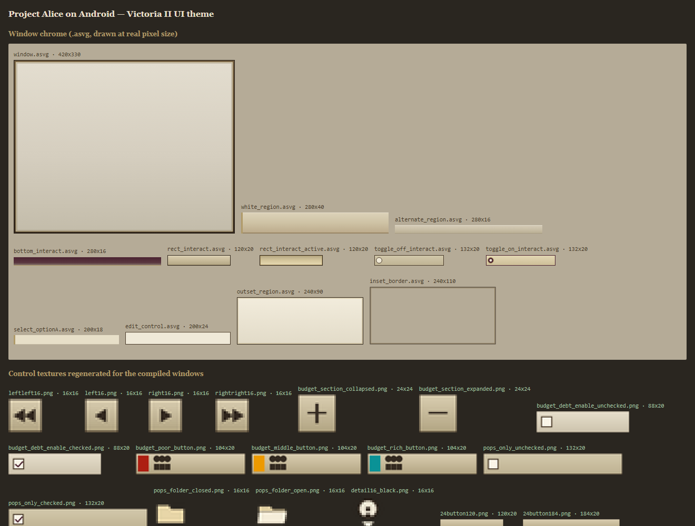

# Project Alice on Android

Android port of [Project Alice](https://github.com/schombert/Project-Alice), an open-source engine for playing Victoria 2. The game runs natively: the same desktop C++ code is compiled for ARM64 and draws with OpenGL ES 3.2.

> **Status:** test version. It already runs on a real device (Moto One Hyper, Android 11, Adreno 612), but expect problems. See [Known limitations](#known-limitations).
>
> **[⬇️ Download the latest version (APK)](https://github.com/Vitorio-Kuroski/Project-Alice-mobile/releases/latest/download/ProjectAlice-Android-arm64.apk)**

## To play

### Requirements

- Android 11 or newer (API 30+)
- 64-bit ARM phone or tablet (arm64-v8a), which is the vast majority of current devices
- GPU with OpenGL ES 3.2
- The **Victoria 2 files with the expansions**, copied to the device. Project Alice does not include the original game content.
- Free space: about 150 MB for the app and its files, plus the Victoria 2 folder

### Installation

1. Download the APK from the [latest version link](https://github.com/Vitorio-Kuroski/Project-Alice-mobile/releases/latest/download/ProjectAlice-Android-arm64.apk); previous ones are under [Releases](https://github.com/Vitorio-Kuroski/Project-Alice-mobile/releases). To test something not published yet, use the **Actions** tab. Open the most recent run of the "Android port - build do APK (arm64-v8a)" workflow and download the `ProjectAlice-arm64-v8a-android-arm64-release-apk` artifact (the optimized build; the one from `android-arm64` is the debug build, much slower).
2. Copy the Victoria 2 folder to the device, for example to `Jogos/Victoria 2` in the internal storage. The right folder is the one containing `common`, `map` and `gfx`. Avoid the `Download` folder and the root of the storage: the Android 11+ folder picker does not let you choose those.
3. Install the APK (you need to allow installation from unknown sources) or use `adb install app-debug.apk`.

### First run

1. The app prepares Alice's own files (shaders, fonts, sounds, texts). This takes a few seconds and only happens again after an update.
2. The **"Victoria 2 folder"** message appears. Tap **Choose folder**:
   - Android asks for the **"All files access"** permission; turn it on and go back to the app (the game reads the files straight from the folder);
   - in the picker, open the Victoria 2 folder and tap **Use this folder**.
3. The first time, the app **builds the scenario** from the game files, which can take several minutes. Meanwhile the screen background pulses. On later runs the scenario is already built and the game opens straight away.

The chosen folder is saved. To change it, delete the `game_folder.txt` file (see [Where the files are](#where-the-files-are)) or clear the app data.

The first time, the app adjusts two options for the device. Both can be changed later in the game options:
- **Interface scale:** chosen from the screen, so the buttons end up a good size for a finger without the game windows no longer fitting.
- **Antialiasing (MSAA): off.** On a phone GPU it is expensive, and on screens of ~400 dpi the jaggies are barely visible.

### Performance

To take the load off the GPU, the game **draws at 75% of the screen resolution** and the device's video hardware upscales the image at no cost. On a 2340×1080 screen it draws at 1755×810, about 44% fewer pixels in the map shader, which is the heaviest one. Text is a little less sharp. The value lives in `render_scale` (`src/window/window.hpp`); there is no in-game option to change it yet.

### Loading

On entering a game the game builds the whole interface at once, and on a phone that takes a few seconds. The same goes for loading a save. At those moments Android's **"Loading..."** window appears. It receives touches while the game is busy, which avoids the "app isn't responding" warning.

### Leaving mid-game

When you switch apps or lock the screen during a game, the game **pauses** and **saves** to `android_autosave.bin`, because Android can close background apps without warning. To continue later, load that save. The file is always the same one (overwritten) and is written at most once every 30 s. It only applies to single-player mode.

### Controls

| Gesture | Equivalent to |
|---|---|
| Quick tap | Left click (select, buttons) |
| Press and hold still for ~0.5 s | Right click (movement order, province menu) |
| Drag over the interface | Drag with the left button (scrollbars, windows) |
| Drag over the map | Move the map |
| Two-finger pinch | Zoom (moving both fingers also drags the map) |
| Three-finger tap | Shows or hides the performance counter: FPS, average and worst frame time, game speed and days simulated per second |
| Back button or gesture | ESC (game menu) |

A mouse (with all three buttons and the wheel) and a physical keyboard, over USB or Bluetooth, work as on the desktop.

### Where the files are

| What | Where |
|---|---|
| Settings, scenarios, saves, `scenario_errors.log` | `Android/data/org.projectalice.mobile/files/.local/share/Alice/` (accessible over a USB cable) |
| Chosen Victoria 2 folder | `Android/data/org.projectalice.mobile/files/game_folder.txt` |
| Alice files extracted from the APK | the app's internal storage (`/data/data/org.projectalice.mobile/files/alice`) |

The app never writes to the Victoria 2 folder.

### Problems? Send the log

```bash
adb logcat -s Alice
```

The log shows every step: file extraction, chosen folder, scenario build and load, OpenGL ES and GPU version, and shader or texture errors.

## To develop

### Building with GitHub Actions

The `.github/workflows/android-port-fase1.yml` workflow runs manually. In the **Actions** tab, choose "Android port - build do APK (arm64-v8a)", click **Run workflow**, select the branch, the preset and, if you want to publish, the **Release tag** (e.g. `v0.3`); once it is filled in, the workflow creates a release on GitHub with the APK and the notes from `android/release-notes.md`. Presets: `android-arm64-release` (default, optimized, for playing) or `android-arm64` (debug, with assertions, for investigating errors). It:

1. validates the shaders as GLSL ES 3.20 and GLSL 4.60 (`android/validate-shaders.sh`);
2. builds on Linux the tools that generate code during the build;
3. builds `libAlice.so` for arm64-v8a with NDK r29, using the chosen preset;
4. generates the APK with Gradle and publishes it as an artifact, together with the build log.

### Signing with a fixed key

Android only installs an APK over another one if both have the same signature. Without a key of your own, each Actions run signs with a new debug key, and the user has to uninstall the app (losing saves and settings) on every version. With the fixed key stored in the repository secrets, every new version updates the previous one.

A release (with the **Release tag** field filled in) **requires** the key: without it the workflow stops right at the start, unless the **release_sem_chave** option is ticked. A build without a tag keeps working without the key, with a warning.

**1. Create the key** (once), on a PC with a JDK (`keytool` comes with Java and with Android Studio) or on the phone itself via [Termux](https://termux.dev) (`pkg install openjdk-17`):

```bash
keytool -genkeypair -keystore alice-release.p12 -storetype PKCS12 -alias alice \
  -keyalg RSA -keysize 2048 -validity 36500 -dname "CN=Project Alice mobile"
```

It asks for a password, which applies to both the key and the file. Then convert the file to text:

```bash
base64 -w0 alice-release.p12 > alice-release.b64     # Linux, Termux
```
```powershell
[Convert]::ToBase64String([IO.File]::ReadAllBytes("alice-release.p12")) | Set-Content alice-release.b64   # Windows
```

**2. Store it on GitHub:** in **Settings → Secrets and variables → Actions → New repository secret**, create:

| Name | Value |
|---|---|
| `ANDROID_KEYSTORE_BASE64` | the contents of `alice-release.b64` |
| `ANDROID_KEYSTORE_PASSWORD` | the password you chose |

**3. Back up** the `alice-release.p12` and the password somewhere safe, outside the repository. GitHub does not let you read a secret back. If the key is lost, the next version again requires uninstalling the app. Never put the key in the repository: with it, anyone can sign an APK that passes itself off as the app.

The "Conferir a assinatura do APK" step of the workflow shows the certificate's SHA-256. It must be the same in every release.

Locally, Gradle uses the fixed key when it finds `ALICE_KEYSTORE` (path to the `.p12`) and `ALICE_KEYSTORE_PASSWORD` in the environment; without them, it uses the machine's debug key.

### Building locally

You need: CMake 3.28+, Ninja, clang, **Android NDK r29**, Android SDK (platform 35, build-tools 35), JDK 17+ and, on Linux, the X11/OpenGL/ICU development packages for the host tools.

```bash
# 1. code generation tools (they run on the PC during the Android build)
cmake --preset x64-debug-linux-clang
cmake --build out/build/x64-debug-linux-clang --target \
  ParserGenerator DCONGENERATOR DCONINTERFACEGEN DataContainer-Lua DataContainer_OOS_Reporter
mkdir -p native-tools
find out/build/x64-debug-linux-clang -type f \( -name ParserGenerator -o -name DCONGENERATOR \
  -o -name DCONINTERFACEGEN -o -name DataContainer-Lua -o -name DataContainer_OOS_Reporter \) \
  -exec cp {} native-tools/ \;

# 2. the native library
export ANDROID_NDK=/path/to/android-ndk-r29
cmake --preset android-arm64-release -DALICE_NATIVE_TOOLS_DIR=$PWD/native-tools   # or android-arm64 (debug)
cmake --build out/build/android-arm64-release --target Alice

# 3. the APK
export ANDROID_HOME=/path/to/android-sdk
android/collect-native-libs.sh out/build/android-arm64-release   # copies the .so files to Gradle (without symbols)
cd android && ./gradlew assembleDebug   # -> app/build/outputs/apk/debug/app-debug.apk
```

To validate the shaders after changing them (requires `glslang-tools`):

```bash
android/validate-shaders.sh
```

### Building locally on Windows

The three stages above work on Windows as well, with different commands. The host tools
are built with MSVC instead of clang, LuaJIT is built by its own Makefile (which needs
`make` and a POSIX shell), and the paths are the usual Windows ones.

#### What you need

| What | Notes |
|---|---|
| JDK 17 or newer | AGP 8.10 requires 17; the build below was verified with 21 |
| Android SDK (platform 35, build-tools 35) | pointed to by `$env:ANDROID_HOME` |
| Android NDK r29 (`ndk\29.0.14206865`) | pointed to by `$env:ANDROID_NDK` |
| Visual Studio Build Tools (MSVC) | builds the 5 host tools |
| MinGW-w64 gcc, **in a path without spaces** | builds LuaJIT's host tools |
| GNU make and a POSIX shell (`sh`, `rm`, `sed`, `install`) | LuaJIT's Makefile |
| Git for Windows | provides `sh`/`rm`/`sed`/`install` and `collect-native-libs.sh` |

#### The commands

```powershell
# 0. environment
$env:ANDROID_HOME = 'D:\dev\SDKs\android-sdk'
$env:ANDROID_NDK  = 'D:\dev\SDKs\android-sdk\ndk\29.0.14206865'
$env:GRADLE_USER_HOME = 'D:\dev\BuildTools\gradle'
$env:JAVA_HOME = 'D:\dev\BuildTools\gradle\jdks\eclipse_adoptium-21-amd64-windows.2'

# space-free gcc first, then make, then the POSIX tools of Git for Windows
$env:PATH = 'D:\dev\BuildTools\mingw64\bin;D:\dev\BuildTools\bin;' + $env:PATH + ';C:\Program Files\Git\usr\bin'

# 1. code generation tools (MSVC; the CI uses the "Visual Studio 18 2026" generator,
#    with VS 2022 Build Tools it is "Visual Studio 17 2022")
cmake -G "Visual Studio 17 2022" --preset=x64-debug-windows -DCMAKE_POLICY_VERSION_MINIMUM=3.5
$tools = @('ParserGenerator','DCONGENERATOR','DCONINTERFACEGEN','DataContainer-Lua','DataContainer_OOS_Reporter')
& cmake --build "out/build/x64-debug-windows" --config Debug --target $tools
New-Item -ItemType Directory native-tools -Force
foreach ($t in $tools) {
  Copy-Item (Get-ChildItem -Recurse -File out\build\x64-debug-windows -Filter "$t.exe") native-tools
}

# 2. the native library (see the traps below before running this)
$env:GIT_RELVER = '[ -e ../.git ] && git show -s --format=%ct >luajit_relver.txt 2>/dev/null || cat ../.relver >luajit_relver.txt 2>/dev/null || :'
$env:MAKEFLAGS = '-e'
cmake --preset=android-arm64-release "-DALICE_NATIVE_TOOLS_DIR=$PWD/native-tools"
& cmake --build "out/build/android-arm64-release" --target Alice -- -j2

# 3. the APK
& 'C:\Program Files\Git\bin\bash.exe' android/collect-native-libs.sh out/build/android-arm64-release
Set-Location android; .\gradlew.bat assembleRelease   # -> app/build/outputs/apk/release/app-release.apk
```

#### Three Windows traps

All three are silent killers: the build stops with an error that points somewhere else.

1. **gcc must not live under a path with spaces.** A MinGW-w64 installed under
   `C:\Users\<a name with a space>\...` cannot link at all: `ld` gets its `-L`
   arguments split at the space and fails with
   `C:/Users/<name>: file format not recognized`. Copy the toolchain to a
   space-free path (e.g. `D:\dev\BuildTools\mingw64`) and put its `bin` first on
   `PATH`.

2. **`make` is not part of a normal Windows install**, and LuaJIT's Makefile does
   not work with `cmd.exe`. Put `mingw32-make.exe` on `PATH` under the name
   `make.exe`, and add a POSIX shell: Git for Windows ships `sh`, `rm`, `sed`,
   `install` and `ln` in `usr\bin`. LuaJIT then builds its host tools
   (`minilua`, `buildvm`) with that gcc.

3. **LuaJIT's Makefile emits `cmd.exe` syntax** for the version step
   (`if exist ..\.git ( ... ) else ( ... )`), which fails under `sh`. Override the
   variable with the POSIX variant and make the environment win:

   ```powershell
   $env:GIT_RELVER = '[ -e ../.git ] && git show -s --format=%ct >luajit_relver.txt 2>/dev/null || cat ../.relver >luajit_relver.txt 2>/dev/null || :'
   $env:MAKEFLAGS = '-e'
   ```

   `MAKEFLAGS=-e` is what makes `make` prefer the environment over the Makefile;
   without it the Makefile's Windows branch wins.

Also worth knowing:

- Quote `-D` arguments in PowerShell (`"-DFOO=bar"`). An unquoted one can be split
  and CMake then reads a stray path as the source directory.
- `-DCMAKE_POLICY_VERSION_MINIMUM=3.5` keeps the older fetched dependencies working
  with CMake 4.x; the Android preset already sets it.
- A release build of `main.cpp` needs several GB of RAM in the compiler. On a small
  machine build with `-j1`.

### How the port works

The native code is built by CMake, not by Gradle. Gradle only packages the `.so`, the Java Activity and Alice's files, and signs the APK.

| Part | File(s) | What it does |
|---|---|---|
| Entry point and loading | `src/entry_point_android.cpp` | `android_main`; extracts Alice's files, finds the Victoria 2 folder, builds or loads the scenario on a separate thread and starts the game |
| Window, EGL and input | `src/window/window_android.cpp` | NativeActivity lifecycle, EGL context (GLES 3.2), render loop, touch, mouse and keyboard |
| OpenGL context | `src/graphics/opengl_wrapper_android.cpp` | `eglMakeCurrent`, vsync and debug output |
| Desktop OpenGL on top of GLES | `src/graphics/android_gl/glew.h` | Replaces GLEW: implements with GLES the desktop functions the game uses and decompresses S3TC/DXT textures when the GPU does not support them |
| Shaders | `assets/shaders/glsl/*`, `ogl::set_shader_prefix` | The same files work as both GLSL 4.60 and GLSL ES 3.20; on Android the `#version` header is swapped on the fly |
| SSE/AVX on ARM | `src/x86_compat/`, `dependencies/simde` | x86 intrinsic headers redirected to [SIMDe](https://github.com/simd-everywhere/simde), which uses NEON |
| Java Activity | `android/app/src/main/java/.../AliceActivity.java` | File permission, folder picker and messages; the rest is C++ |
| Packaging | `android/app/build.gradle.kts`, `android/collect-native-libs.sh` | `.so` in `jniLibs`; the repository's `assets/` inside the APK with a list (with CRC32) for extraction |

Other decisions worth knowing about:

- **Optimizations for phone GPUs:** rendering at 75% of the resolution (`ANativeWindow_setBuffersGeometry`; touch and mouse are converted to the drawing scale), MSAA off by default, `glInvalidateFramebuffer` of depth/stencil before every frame swap (avoids writing them to memory on a GPU that renders in tiles) and `-mtune=cortex-a76` (only tunes the choice of instructions; it still runs on any arm64).
- **LuaJIT** is linked statically on Android. Its `.so` has a name with a version (`libluajit-5.1.so.2`), which Android does not load from inside the APK.
- **ICU:** the game only uses ICU's text breaking (characters, words and lines). On Android 12+ it comes from the system (`libicu.so`, loaded with `dlopen`). On Android 11, which has no public ICU for apps, a custom implementation in `src/text/icu_android_compat.hpp` steps in. Compared with ICU on Alice's localization texts, it gives the same line breaking in ~99% of English, German and Russian sentences; Chinese and Japanese are approximate.
- **Filesystem:** it is the same as on Linux (`simple_fs_nix.cpp`). `$HOME` points to the app's external folder, and the game roots are `[Victoria 2 folder, internal folder with assets/]`.
- **Closing the app** ends the process: the game threads and static state cannot be reused by a new Activity.

### Victoria II look for the new UI

The in-game windows built with Alice's new UI system (budget, population, production, trade, reports, ...) take their chrome from `assets/svg/*.asvg`, their colours and control templates from `assets/the.tui`, and their layout from `assets/*.aui`. Upstream the chrome is a plain off-white fill, which on a phone reads as a blank white spreadsheet. It has been restyled to Victoria II's palette:

| File | Role |
|---|---|
| `assets/svg/window.asvg` | main window: dark bevelled frame, parchment body, double gold rule |
| `assets/svg/thin_border_window.asvg`, `inset_border.asvg`, `outset_region.asvg` | secondary windows, inset panels, popups and tooltips |
| `assets/svg/white_region.asvg` | row header tabs (tan band with a gold marker on the left) |
| `assets/svg/alternate_region.asvg` | list and table rows (parchment band with hairline rules) |
| `assets/svg/bottom_interact.asvg` | table column headers (maroon banner fading downwards) |
| `assets/svg/rect_interact*.asvg`, `toggle_*`, `select_optionA`, `edit_control` | buttons, checkboxes, list selection, text fields |

`src/gui/budgetwindow.cpp` adds the Victoria II "value tiles": the budget amounts are drawn on small cream note tiles instead of as bare text.



The `.aui` files also reference about 30 control textures (`budget_poor_button.png`, `left16.png`, `budget_debt_enable_checked.png`, `pops_folder_closed.png`, ...) that were never committed upstream, so those buttons, checkboxes and slider arrows drew nothing at all. `tools/make_vic2_assets.py` regenerates them in the same style; their sizes come from the element geometry stored in the `.aui` files.

One trade-off worth knowing: the text colour of every label is baked into the compiled `.tui`/`.aui` and it is dark ink everywhere. Victoria II draws its section titles as light text on maroon banners; with a fixed dark ink colour that would be unreadable, so section headers use tan tabs with a gold marker and the maroon is kept for table headers and popups.

#### Working on the UI without building the game

`tools/` contains small Python helpers for this (only `make_vic2_assets.py` needs Pillow):

| Tool | What it does |
|---|---|
| `tools/aui_dump.py assets/budgetwindow.aui` | decodes a compiled window: every element with its position, size, template id and texture |
| `tools/tui_dump.py assets/the.tui` | decodes the template library: backgrounds (which SVG each one is), colours, and the template to background mapping |
| `tools/asvg_preview.py out.html` | substitutes the `[[W;...]]`/`[[H;...]]`/`[[P;...]]` placeholders so the `.asvg` chrome can be rendered in a browser and checked |
| `tools/make_vic2_assets.py` | regenerates the missing control textures |

In an `.asvg`, a placeholder resolves to `scale * axis + offset`, where `axis` is half the element size in grid units and one SVG unit is `500 / grid_size` pixels. On the standard 8 px grid one pixel is therefore `62.5` units, which is why the frame insets in those files are multiples of it.

### Known limitations

- **Tested on a single device** so far (Moto One Hyper, Adreno 612). Other GPUs (Mali, PowerVR) have not been tested yet.
- **Mods:** base game only; a mod selection screen is missing.
- **Typing text** (save name, chat) does not work: the native API does not deliver the virtual keyboard's characters. This needs a JNI bridge.
- **Box selection** of several units with a finger does not exist yet; you can select one at a time.
- **Resuming after Android closes the app:** the background save is made, but you have to load it manually from the menu.
- **Touch values** (hold time, movement tolerance, pinch zoom speed) are guesses to be tuned with testing.
- **arm64-v8a only.**
- **Memory:** decompressed S3TC textures take up more video memory on GPUs without S3TC support (Mali, PowerVR).
- **DataContainer** is downloaded from the `master` branch with no fixed version, and a change there can break the build.
